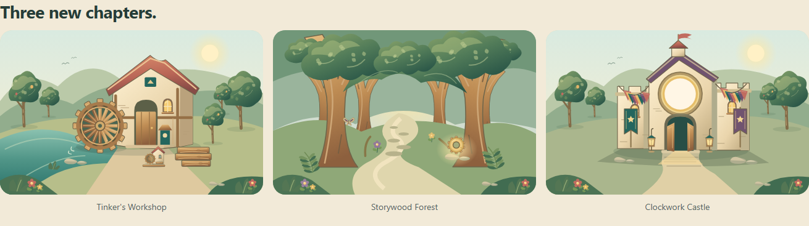

# WP02-08A — frozen M2 original-art candidate

11 October 2026. **Producer complete; ready for original independent media review.**
No commit, main-source mutation, deployment, production build or new worker.
Private candidate archived from accepted main
`9485a2cf67b0703deb4efa6c178602dc7952f705`, under the direct human scheduling
override in CONTINUATION-AND-MUSIC-VARIATION. Acoustic acceptance stays separate.
The existing standard-build context governed this single authored family;
serial authoring follows the explicit no-new-workers assignment.

## Candidate, overview and safe integration

Candidate root:
`C:/Users/alexb/Documents/ChatGPT/Learning is Fun/artifacts/wp02-08a-20261011/candidate`

Actual compact overview (not a mockup):
`C:/Users/alexb/Documents/ChatGPT/Learning is Fun/artifacts/wp02-08a-20261011/candidate/assets/source/art/m2/evidence/overview-three-scenes.png`



Controller deliverables beside the candidate: `art-only.patch`,
`art-only-files.json` and `freeze.json`. The patch adds only this handoff and
owned M2 source/runtime/evidence files. It deliberately **does not patch the
whole asset register**. The patch excludes the private baseline register copy,
private caches, archive, dependency paths and all unchanged inherited files.

For byte-exact application, use command-local `-c core.autocrlf=false` with
`git apply --check` and `git apply`; the inherited palette helper retains its
original CRLF lines. `-c core.whitespace=cr-at-eol` recognises those line endings.
The outer freeze verifies a private application against every listed file hash.

Merge `assets/source/art/m2/asset-register.delta.json` by its exact 28 IDs:
check `expectedBefore`, then replace only those M2 rows with `records`. Preserve
the current main schema and every M1/audio row. The Controller's reviewed new
music rows were integrated after this candidate's frozen base; this candidate's
complete private register is NOT a replacement for main. Runtime audio paths
are unchanged, so the complete ready path list remains useful, but its contents
do not certify the current music measurements or acoustic quality.

No reader/writer lease on main was exercised. The private browser and Vite
server are closed; port **5198 released**. Port 5196 and user sessions untouched.

## Finished inventory

**28/28 planned M2 SVGs ready; 196,292 runtime bytes.** Each filename below has
editable source `assets/source/art/m2/<filename>` and byte-identical runtime
`public/assets/art/m2/<filename>`; load the latter with the base-relative
`assets/art/m2/<filename>` through `assetUrl`. ViewBox is `0 0 width height`.

| Asset ID | Filename | Dimensions | Bytes |
|---|---|---:|---:|
| scene-tinkers-workshop | scenes/tinkers-workshop.svg | 960×600 | 33966 |
| scene-storywood-forest | scenes/storywood-forest.svg | 960×600 | 26208 |
| scene-clockwork-castle | scenes/clockwork-castle.svg | 960×600 | 21636 |
| green-garden | scenes/green-garden.svg | 960×600 | 12552 |
| green-finale | scenes/green-finale.svg | 960×600 | 7866 |
| castle-finale | scenes/castle-finale.svg | 960×600 | 9519 |
| library-shelf | scenes/library-shelf.svg | 960×600 | 4026 |
| orin | characters/orin.svg | 320×320 | 4816 |
| array-surround | props/array-surround.svg | 320×320 | 2759 |
| potion-surround | props/potion-surround.svg | 320×320 | 3019 |
| book-surround | props/book-surround.svg | 320×320 | 2715 |
| story-panel | props/story-panel.svg | 320×320 | 2774 |
| map-surround | props/map-surround.svg | 320×320 | 2725 |
| clock-surround | props/clock-surround.svg | 320×320 | 2782 |
| castle-gear | props/castle-gear.svg | 240×240 | 4465 |
| forest-marker | props/forest-marker.svg | 240×240 | 5251 |
| forest-story-map | props/forest-story-map.svg | 240×240 | 6774 |
| forest-tale | props/forest-tale.svg | 240×240 | 2977 |
| sawmill-model | props/sawmill-model.svg | 240×240 | 9459 |
| forest-moth | props/forest-moth.svg | 240×240 | 2816 |
| decoration-tree | props/decoration-tree.svg | 240×240 | 4325 |
| decoration-bench | props/decoration-bench.svg | 240×240 | 3867 |
| decoration-lantern | props/decoration-lantern.svg | 240×240 | 3296 |
| decoration-banner | props/decoration-banner.svg | 240×240 | 3260 |
| decoration-pond | props/decoration-pond.svg | 240×240 | 4155 |
| home-trim | props/home-trim.svg | 960×600 | 3318 |
| scarf-star | props/scarf-star.svg | 300×320 | 2603 |
| scarf-wave | props/scarf-wave.svg | 300×320 | 2363 |

[Manifest](../../../assets/source/art/m2/manifest.json) records every exact path,
viewBox, byte length, SHA-256, layer ID and result ID. The
[28-row delta](../../../assets/source/art/m2/asset-register.delta.json) includes
actual rights and dimensions. [Required runtime delta](../../../assets/source/art/m2/required-runtime.delta.json)
contains 28 paths; [complete ready path set](../../../assets/source/art/m2/required-runtime.complete.json)
contains 72 paths (37 inherited M1 SVGs, 28 M2 SVGs, seven inherited audio keys).
Only runtime exports belong in publication/precache.

## Layer, crop and consumer contract

Every internal ID is export-prefixed, including gradients. Each new scene owns
`-background`, `-middle`, `-landmark`, `-foreground`, `-initial`. Result groups
ship with `style="display:none"` and `data-result` equal to the catalogue ID.
Reveal only committed results and hide the specified initial group. Do not
derive progression or saved facts from art. Reset conditional groups when the
profile/scene changes. Inline duplicates must namespace IDs/references per
instance; preview blob images isolate them. No scripted SVG or animation needed.

| Quest / fact | Export and layer or prop |
|---|---|
| Q4 sawmill-restored | `scene-tinkers-workshop-sawmill-restored`; replaces `-initial` broken wheel/limited timber with complete paddles, warm window, supplies and water accent |
| Q4 invention-available | `sawmill-model`, independent 240×240 prop; one invention, not another character/location |
| Q5 garden-restored | `green-garden-garden-restored`, 960×600 overlay on unchanged village-green |
| Q5 forest-marker | `forest-marker`, grown timber sign; placement example x715/y337, 120×120 |
| Q6 books-shelved | `library-shelf-books-shelved`, 960×600 overlay on unchanged whispering-library |
| Q6 forest-story-map | `forest-story-map`, recovered display book/map; separate earned prop |
| Q7 forest-path-restored | `scene-storywood-forest-forest-path-restored`; hides `-initial` branches; `forest-tale` is its separate discovered book |
| Q8 castle-gear-recovered | `scene-storywood-forest-castle-gear-recovered` highlights gear at the root; `castle-gear` is its reusable prop |
| Q9 castle-clock-restored | `scene-clockwork-castle-castle-clock-restored`; hides `-initial` dull clock wash |
| Q9 castle-open | `scene-clockwork-castle-castle-open` replaces the closed entrance; independently addressable from clock illumination |
| Q10 kingdom-finale | `green-finale-kingdom-finale` and `castle-finale-kingdom-finale`, separate 960×600 overlays |

[bindings.json](../../../assets/source/art/m2/bindings.json) is the exact art
handoff matrix, including locations, live-content rectangles, cosmetic offsets,
six socket centres and all three derived shelf-display requirements. It adds no
world implementation or replacement catalogue. The preview shows all applicable
results together for visual comparison; downstream WP02-10A/11A must select each
from its own frozen quest/entitlement fact.

Preserve scene aspect 960:600 with `contain`; do not crop the landmarks. Quiet
instructions sit beside the scene in landscape and below it in portrait. The
castle clock aperture is centred `(490,233)`, safe radius 52; the art deliberately
contains no hands, numerals or clock marks. `clock-surround` has centre `(160,151)`,
safe radius 100. Actual time/assessed graphics come from reviewed WP03 data and
TaskStimulus, never from these blank surroundings. The gear's decorative teeth,
story-map cover illustration and castle ornament are not task-data diagrams.

Orin is the only new named cast: teal caretaker coat/cap, grey beard and brass
key, full 320×320 portrait. Use the full square at small scale; for a face-only
crop keep the cap and beard (approximately x80–235/y15–220). Existing avatars and
all four named M1 characters are unchanged; Rowan serves both village/workshop.

Five new decoration exports plus inherited `decoration-planter` make **six**,
all 240×240. The source-ground baseline is around y210; preview places 120×120
instances at `(socketX-60, socketY-108)`. Six socket centres: x310/490/668 at
y468, then x310/490/668 at y548. The first three are inherited scene art; the
additional three reuse `plot-socket` at 112×46.667 centred on the same ground
anchor. Do not duplicate the first three rims. All six follow M2's existing Q3
availability; Q5 garden art is not a gate. Native hit targets/labels remain ≥44px
consumer work, independent of visual size. This is finite decoration, no physics.

`home-trim-facade-trim` aligns at `(0,0)` on the original 960×600 home scene.
`scarf-star-pattern` and `scarf-wave-pattern` align at `(0,0)` on the shared
300×320 Pip/scarf canvas, after the chosen M1 colour. Leaf remains the third
earned pattern. Do not stack earned patterns or scale them independently.
Entitlement thresholds/save behaviour stay with the existing owners.

The shelf's furniture overlay contains decorative shelved spines. Its story
display props remain independently gated: spellbook Q2, forest-story-map Q6,
forest-tale Q7. Example positions are in bindings.json; no new award/save flag.
Three new non-scored discoveries reuse sawmill-model, forest-moth and castle-gear.

## Visual evidence and corrections

Actual final renders inspected at **1366×768, 1024×768 and 768×1024**. Each
`comparison-<scene-id>-<width>.png` contains initial/restored/static states for
the three new locations and the affected green/library. `cast-<width>.png`,
`creative-<width>.png`, `props-<width>.png` and `preview-<width>x<height>.png`
cover Orin beside the inherited cast, six decorations/sockets, three patterns,
all activity/discovery props and quiet layout. This is a bounded M2 review set,
not another M1 acceptance packet.

- Workshop: recognisable complete timber wheel, warm plaster/wood, supplies
  and miniature invention; broken paddles visibly distinguish the initial state.
- Forest: a shaded leafy arch, winding pale path, fern/moth details and root gear.
  Initial branch ends looked cut and earlier helper shadows floated against
  trunks. Covered branch tips with authored foliage and removed those misplaced
  shadows; inspected the final path clearances and leaves at portrait scale.
- Castle: stepped cream towers and a large clock aperture. Initial finale bunting
  crossed the aperture and the top pennant touched the edge; moved bunting onto
  side towers and lowered the turret/pennant. Removed decorative stars from the
  live clock area so it remains clear for actual values.
- Green/library: overlays register against unchanged M1 bases. Removed duplicate
  socket rims in the creative comparison; moved the last shelf book inward so it
  rests within the shelf. Home trim, garden, marker and finale retain the original
  doors/windows and foreground action space.
- Orin and patterns: expressive but restrained M1-compatible shape language;
  key/cap fit within the portrait, star/wave embroidery stays on the scarf.

`early-overview.png` retains superseded draft evidence. The compact final
`overview-three-scenes.png` is the human/Controller review image.

## Verification, rights and limits

- `build-art.mjs`: exactly 28 deterministic, local source/runtime SVG pairs.
- `measure-art.mjs`: PASS; dimensions/bytes/hash/source equality, unique prefixed
  IDs, resolved local references, required scene layers, declared result bindings,
  no scripts/remote/image dependencies or baked text. All 37 inherited M1 pairs
  match their recorded hashes; all 44 non-M2 private registry rows unchanged.
- `inspect-art.mjs`: PASS in Playwright Chromium **156.0.8078.4**. Five affected
  compositions × three viewports: initial differs from restored; restored/static
  decoded pixels identical. 92 displayed images per final viewport, zero broken
  images, page/console errors, external requests or horizontal overflow. All
  preview controls ≥44px wide and 48px high. Browser sandbox enabled.
- Direct Node TypeScript 7.0.2 preview check: PASS with a physical private config,
  `composite:false`, `incremental:false`, `noEmit:true`; no shared buildinfo.
- Archive comparison and patch allowlist are recorded in the outer freeze files.
  No inherited source/export/audio bytes are an integration target.

The fixture uses DEC-027 `mountPanel` and `assetUrl`. A private Vite server with
`configFile:false`, explicit source root and `.private-cache/vite-art` reads
existing dependencies without shared junctions. No pnpm/install, production
build, PWA, deployment or shared cache writes. Normal filesystem-sandbox Chromium
crashed before opening a page; approved normal-user execution succeeded with
Chromium sandboxing retained. Every inspection closes browser and port 5198.

Reproduce from the candidate root using direct Node:

```powershell
$env:ART_TOOLS_ROOT='C:/Users/alexb/Documents/ChatGPT/Learning is Fun'
node assets/source/art/m2/inspect-art.mjs
```

Original authorship/project-use statement is retained in
[PROVENANCE.md](../../../assets/source/art/m2/PROVENANCE.md). No paid tool or
external artwork licence; no invented CC0/GPL assignment. This is finished art
and Chromium layout evidence, **not branded D1 Chrome, WebKit/physical-tablet,
actual touch, child testing, gameplay/state/accessibility, publication/offline or
acoustic acceptance**. WP02-10A/11A compose the committed states; published
WP02-13A/WP06 findings can return asset causes here. After freeze this author is
idle, awaiting specific review corrections.
